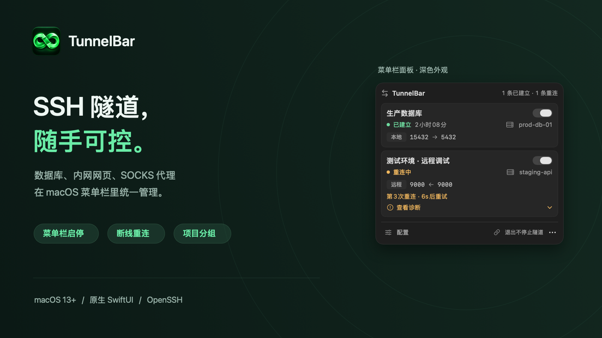
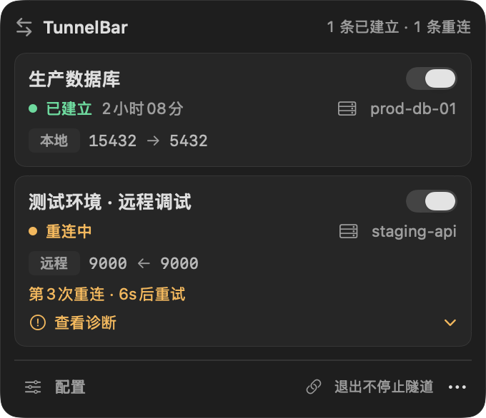
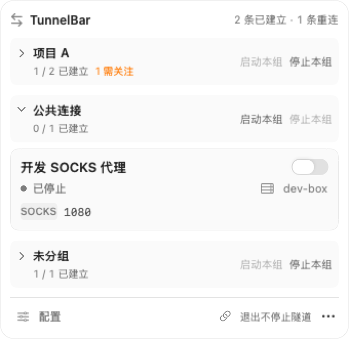
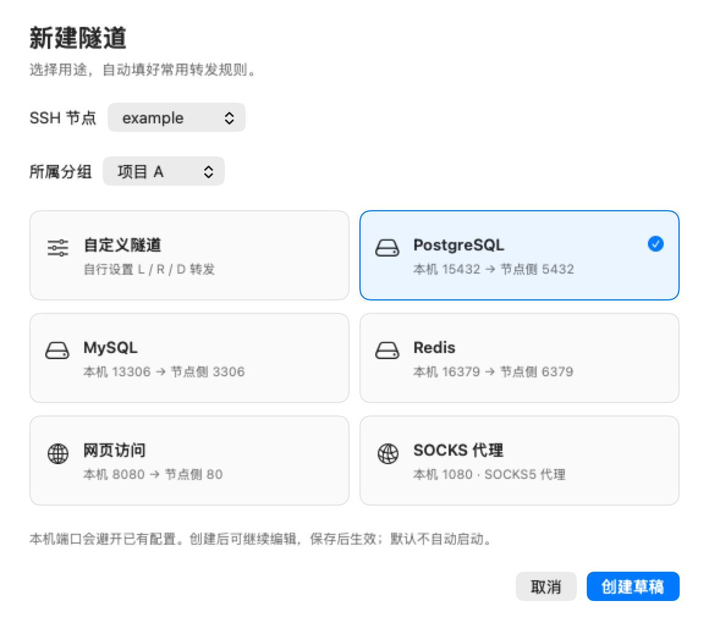
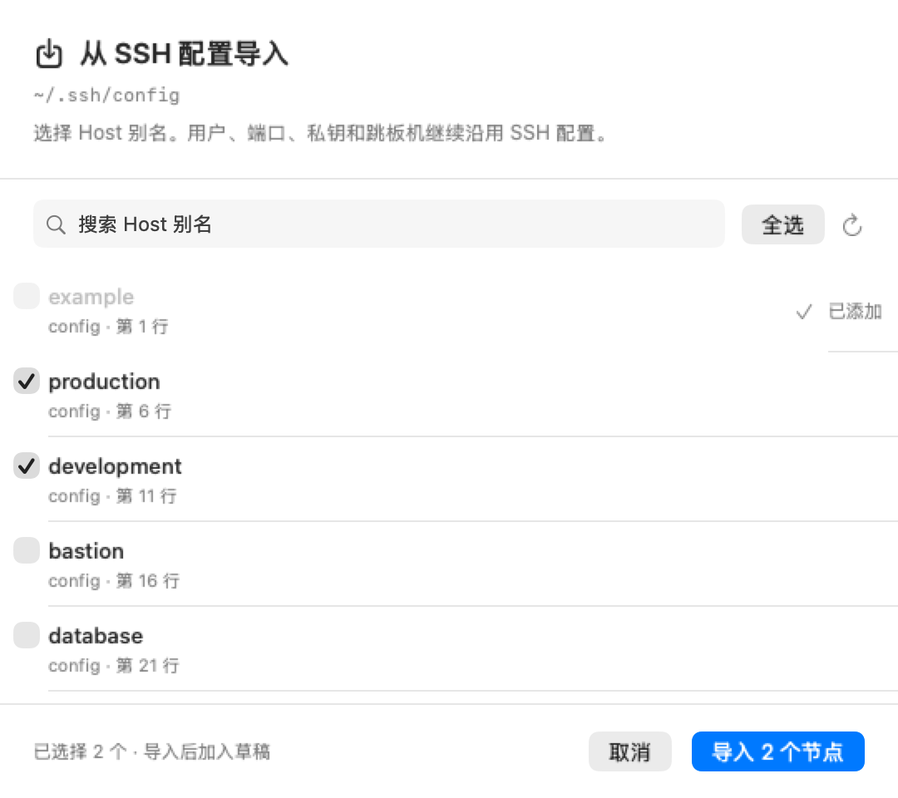
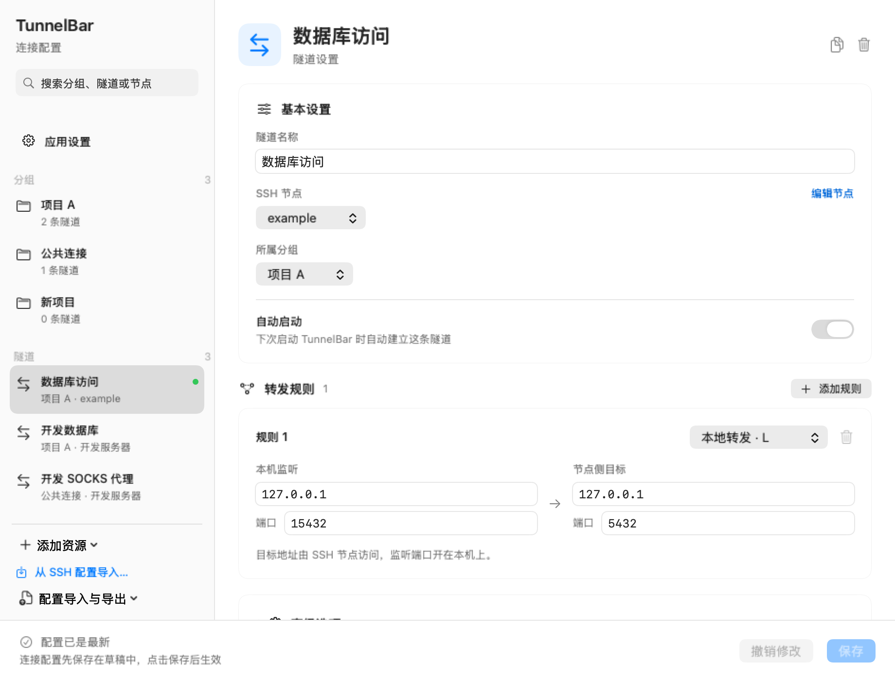

<h1 align="center">TunnelBar</h1>

<p align="center"><strong>SSH 隧道，随手可控。</strong></p>
<p align="center">macOS 菜单栏 SSH 隧道管理器 · macOS 13+ · 原生 SwiftUI</p>
<p align="center">
  <a href="#快速上手">快速上手</a> ·
  <a href="docs/user-guide.md">使用指南</a> ·
  <a href="docs/development.md">开发与构建</a>
</p>



访问远程数据库、打开内网网页、使用 SOCKS 代理——把常用 SSH 转发保存下来，在菜单栏里随时启停、查看状态。适合每天需要连接开发、测试或生产环境的 macOS 用户。

## 你的连接，一眼看清

| 连接状态与重连 | 按项目管理连接 |
| :---: | :---: |
|  |  |

- **开关即启停**：连接状态、运行时长、节点和转发端口都在卡片上。
- **断线自动重连**：网络恢复后继续尝试；认证失败、端口占用等问题会显示处理建议。
- **按需分组**：默认直接展示隧道；创建分组后可整组启停，公共数据库和代理可以独立管理。
- **退出仍保持连接**：重启 TunnelBar 后接管已有 SSH 进程，恢复监控。

## 选一个模板，就能开始

常用的 PostgreSQL、MySQL、Redis、网页访问和 SOCKS 模板会填好转发规则；已有 `~/.ssh/config` 的用户，也可以直接选择 Host 别名导入节点，沿用密钥和跳板机设置。

| 选择用途，创建隧道 | 复用现有 SSH 配置 |
| :---: | :---: |
|  |  |

模板默认只监听 `127.0.0.1`，创建后可以继续调整端口和目标地址。新建和导入先进入草稿，保存后生效。

## 配置也有图形界面

分组、SSH 节点和转发规则集中编辑。本地转发（L）、远程转发（R）和 SOCKS 代理（D）都可配置；保存前会校验输入，并列出将启动、停止或重连的隧道。



*以上图片由真实 SwiftUI 界面使用通用演示数据渲染。*

## 能用来做什么

| 场景 | 用法 |
| --- | --- |
| 远程数据库 | 将服务器侧的 PostgreSQL、MySQL 或 Redis 转发到本机端口，用熟悉的数据库客户端连接。 |
| 内网网页 | 经 SSH 节点访问内部服务，在本机浏览器打开转发后的地址。 |
| SOCKS 代理 | 创建动态转发，把浏览器或其他支持 SOCKS 的应用指向本机代理端口。 |
| 远程调试 | 用远程转发让 SSH 服务器侧通过指定端口访问本机开发服务。 |

## 快速上手

需要 **macOS 13+** 和 **Xcode Command Line Tools**（提供 `swiftc`）。在项目目录中构建并打开：

```bash
./build.sh
open build/TunnelBar.app
```

1. 点击菜单栏里的 TunnelBar 图标，打开「配置」。从 SSH 配置导入节点，或手动填写服务器信息。
2. 在「添加资源 → 新建隧道」中选择节点和模板，确认监听端口与目标地址，点击「保存」。
3. 回到菜单栏面板，打开隧道开关。显示「已建立」后，通过配置的本机端口访问服务。

首次启动为空配置。需要自动连接时，开启隧道的「自动启动」；需要登录后打开应用时，在「应用设置」中开启「登录时启动 TunnelBar」。

## 连接与本地数据

退出 TunnelBar 会保留正在运行的 SSH 连接；要断开连接，请使用隧道开关、「停止本组」或「全部停止」。**自动重连需要应用保持运行**，应用退出期间断开的隧道会在下次启动时按配置恢复。

配置、PID 和诊断日志保存在本机 `~/.config/tunnel-bar/`，节点只记录私钥路径。配置可导入、导出，迁移到另一台 Mac 后需准备对应的密钥和 SSH 配置。

详细操作、连接诊断和配置格式见 [使用指南](docs/user-guide.md)；构建、测试和截图更新见 [开发与构建](docs/development.md)。
